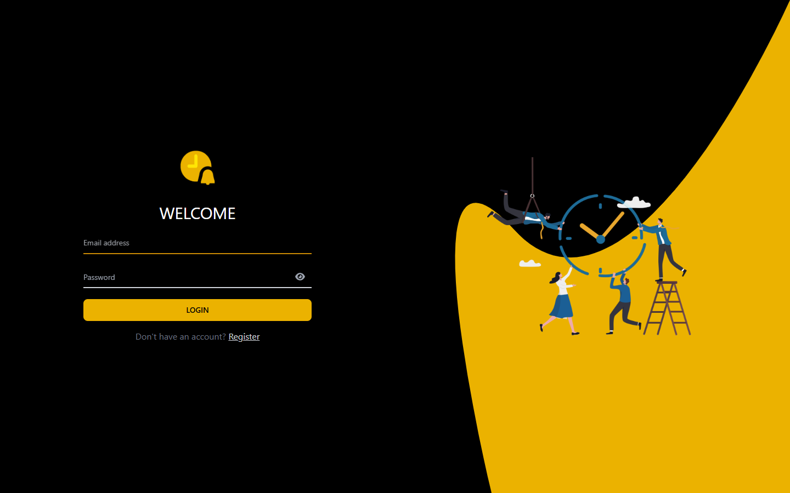
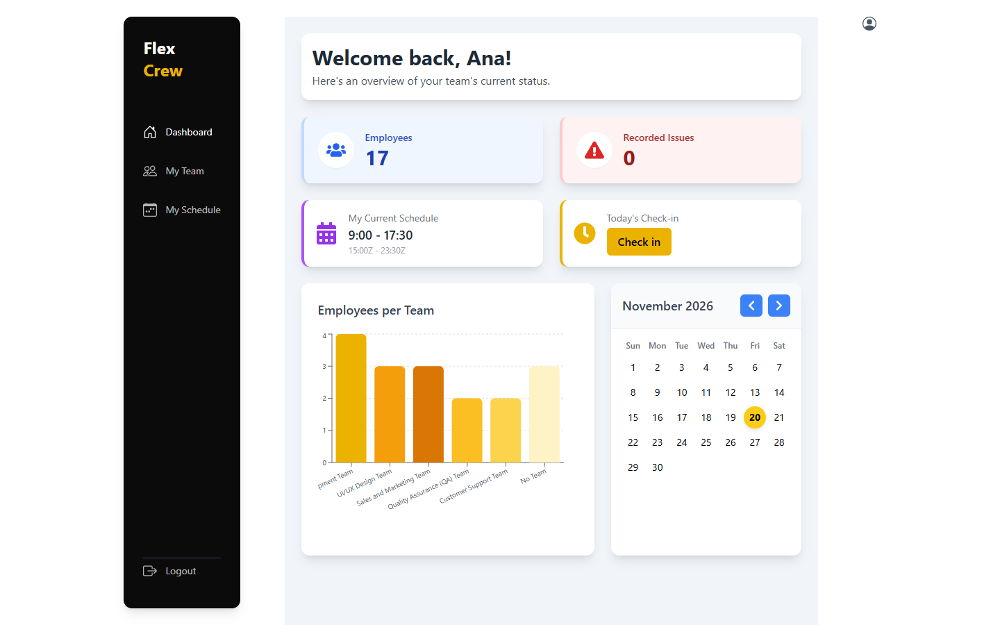

# Flex-Crew

Flex-Crew is a workforce scheduling and attendance web app. Employees see their schedule and team
and check in once a day; admins manage schedules and see punctuality and schedule-load statistics.
The backend is a Spring Boot REST API with JWT authentication, and the frontend is a React and
TypeScript single-page app.





## Features

### Every signed-in user (USER and ADMIN)

- Register and sign in. Registration always creates a USER account.
- Dashboard: employee count per team, number of recorded issues, the user's current schedule and a
  **Check in** button. The server records the check-in time; it is accepted once per day and only
  within 60 minutes before or after the start of the user's schedule.
- My Team: a searchable list of employees.
- My Schedule: the user's current schedule in a weekly calendar.
- Profile (account menu): personal details and a password change, which needs the current password.
- Sign out, which also revokes the refresh token on the server.

### ADMIN only

- Manage Schedules: create, edit and delete schedules. Deleting asks for confirmation first.
- Admin Dashboard: punctuality statistics and the load of each schedule (assigned vs. maximum
  employees).
- Team weekly schedule for the team the admin manages.
- Projects: a project list and a project page with team-based assignment suggestions. The links are
  in the admin panel. Reading projects is allowed for any signed-in user; creating, updating and
  deleting them is ADMIN-only in the API, and the UI has no forms for it.
- Through the API only: assign a schedule to an employee, get a suggested schedule for a team, read any
  employee's attendance records, and check in on behalf of an employee.

## Architecture

```
browser ──> frontend (nginx in Docker, Vite in dev) ──/api──> backend (Spring Boot, :8081) ──> PostgreSQL
```

- `backend/`: Java 17, Spring Boot 3.2, Spring Security, Spring Data JPA, jjwt.
  Packages under `com.lazardev.FlexCrew`: `controller`, `service`, `dao` (repositories), `entity`,
  `dto` and `security` (JWT filter, token services, security config).
- `frontend/`: React 18, TypeScript, Vite, Chakra UI, Tailwind CSS, axios, Recharts. All API calls
  use relative `/api` URLs; Vite (dev) and nginx (Docker) proxy them to the backend, so the browser
  only talks to one origin.
- Database: PostgreSQL 16. `scripts/database-creation.sql` creates the `Flex-Crew-v1` schema and
  sample teams, schedules, employees and projects.

## Running with Docker

Needs Docker with Compose.

```bash
cp .env.example .env
# Edit .env: set POSTGRES_PASSWORD, and SECRET_KEY to a base64 key of at least 256 bits:
openssl rand -base64 32
docker compose up --build
```

Open http://localhost:5173. `.env` is gitignored.

Compose starts three services, each with a healthcheck, and each waits for the one it depends on to
be healthy:

- `db`: PostgreSQL 16. On the first start with an empty volume it runs
  `scripts/database-creation.sql`.
- `backend`: the API (`backend/Dockerfile`, Eclipse Temurin 17). It is not published to the host.
- `frontend`: the production build served by nginx (`frontend/Dockerfile`), which proxies `/api` to
  the backend. Published on port 5173.

Stop with `docker compose down`. Adding `--volumes` also deletes the database.

To use the app, register an account. New accounts are USER and have no schedule, so check-in
answers "No schedule assigned" until one is set. To make an account an admin, run this with the
`POSTGRES_USER` and `POSTGRES_DB` values from `.env` (`flexcrew` in the template), then sign in
again:

```bash
docker compose exec db psql -U flexcrew -d flexcrew \
  -c "UPDATE \"Flex-Crew-v1\".\"Employees\" SET role = 'ADMIN' WHERE email = 'you@example.com';"
```

An admin can then assign a schedule with `POST /api/schedules/assign/{employeeId}/{scheduleId}`.

## Running locally without Docker

Needs JDK 17, Node 24 and a PostgreSQL database on which `scripts/database-creation.sql` has run.

1. Copy `backend/src/main/resources/env.properties.example` to `env.properties` in the same folder
   (gitignored) and fill it in. Use `DB_SCHEMA_NAME=Flex-Crew-v1`.
2. Backend: `cd backend && ./mvnw spring-boot:run` (port 8081).
3. Frontend: `cd frontend && npm ci && npm run dev` (port 5173, proxies `/api` to 8081).

Logging is at WARN by default. For SQL and security debugging, start the backend with, for example:

```bash
./mvnw spring-boot:run -Dspring-boot.run.arguments="--spring.jpa.show-sql=true --logging.level.org.springframework.security=DEBUG"
```

Do not turn on `logging.level.org.hibernate.orm.jdbc.bind=trace` outside local debugging: it logs
query parameters, including password and token hashes.

## Tests

```bash
cd backend && ./mvnw test        # 109 tests; needs Docker for the Testcontainers tests
cd frontend && npm ci && npm run lint && npm run build && npm test   # 20 tests (Vitest)
```

Backend tests by class:

| Class | Tests | What it covers |
| --- | --- | --- |
| `SecurityRulesTests` | 77 | Role and ownership rules, 401/403 responses, login, refresh-token rotation and reuse, logout, server-set check-in, no password hashes in JSON |
| `AnalyticsServiceTests` | 10 | Punctuality and schedule-load calculations |
| `AuthenticationServiceTests` | 9 | Registration, login and token handling in the service |
| `RefreshTokenPersistenceTests` | 4 | Refresh tokens against real PostgreSQL (Testcontainers) |
| `AnalyticsControllerTests` | 4 | Analytics endpoints |
| `FlexCrewApplicationTests` | 3 | Full application on PostgreSQL (Testcontainers), public health endpoint |
| `ProjectControllerTests` | 1 | Project endpoint |
| `RegistrationSchemaTests` | 1 | Registration against the real schema (Testcontainers) |

The frontend tests cover the axios refresh-on-401 logic, the auth provider, route protection, the
registration form, the check-in card and error-message handling.

## Security design

- **Access tokens**: JWTs signed with HMAC-SHA (key from `SECRET_KEY`), valid for 15 minutes. Each token is
  also stored server-side, so it can be revoked before it expires. Missing or invalid tokens get
  401.
- **Refresh tokens**: valid for 7 days and stored only as SHA-256 hashes (`Refresh_Tokens` table).
  Every refresh rotates the token. Presenting a token that was already used revokes all of that
  user's refresh tokens, so a stolen token stops working once either party uses it.
  `POST /api/auth/logout` revokes the current refresh token.
- **Frontend refresh**: on a 401 the axios client refreshes once and retries the request. Parallel
  requests share a single refresh call, so a rotated token is never sent twice. If the refresh
  fails, the user is signed out.
- **Authorization**: method-level checks (`@PreAuthorize`) on the controllers. Mutations of
  schedules and projects, employee creation and analytics are ADMIN-only. Attendance records can
  be read or created only by their owner or an admin.
- **Accounts**: registration always creates a USER. Passwords are hashed with BCrypt, and the
  password field is write-only in JSON, so hashes are never returned.
- **Check-in integrity**: the server sets the check-in time and takes the schedule from the
  database. Time or schedule values in the request body are ignored.

These rules are tested against the real `SecurityConfiguration` with real JWTs (MockMvc in
`SecurityRulesTests`, PostgreSQL via Testcontainers in `RefreshTokenPersistenceTests`), not with a
permit-all test configuration.

## CI

`.github/workflows/ci.yml` runs on pushes to `main` and on pull requests:

- `backend`: `./mvnw test` on JDK 17.
- `frontend`: `npm ci`, lint, build and Vitest on Node 24.
- `docker`: builds and starts the full Compose stack with generated secrets, waits for all
  healthchecks, then registers and signs in a user through the frontend's `/api` proxy.

## Known limitations

- **Refresh token in `localStorage`**: any XSS on the page could read it. An httpOnly, Secure,
  SameSite cookie would hide it from JavaScript, but needs CSRF protection on the refresh and
  logout endpoints. Rotation and reuse detection limit the damage today.
- **No migrations**: `spring.jpa.hibernate.ddl-auto=update` manages the schema. Flyway migrations
  would be safer.
- **One session per user**: signing in or refreshing revokes the user's other access tokens, so
  two devices keep invalidating each other's access tokens and refresh more often than needed.
- **Attendance is a single daily check-in**: there is no check-out, so breaks, overtime and hours
  worked are not tracked. "Today" is the server's date, and past check-ins are only available
  through the API.
- **Schedule assignment is API-only**: the UI cannot assign a schedule to an employee.
- **Sample data passwords**: the seeded employees' password is not documented; register a new
  account instead.
